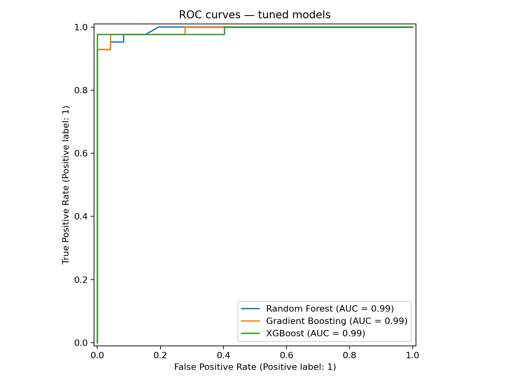
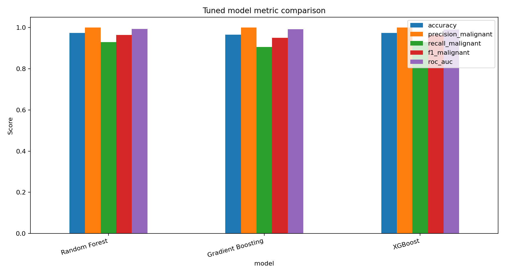
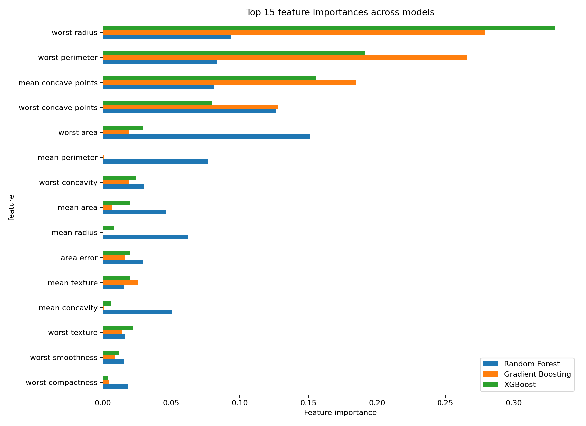

# Ensemble Learning Benchmark

A reproducible comparison of **Random Forest**, **Gradient Boosting**, and **XGBoost** on the Breast Cancer Wisconsin Diagnostic classification dataset.

> Educational machine-learning project only. This is not a medical diagnostic tool.

## What it does
- Uses one stratified train/test split for all models.
- Evaluates baseline and tuned models.
- Tunes on training data only with stratified cross-validation and ROC-AUC scoring.
- Reports accuracy, precision, recall, F1, ROC-AUC, training/prediction time, and train-test gap.
- Creates confusion matrices, ROC curves, metric/time plots, and feature-importance comparisons.
- Exports CSV/JSON results and a generated Markdown report.

## Setup (Windows PowerShell)

```powershell
py -3.11 -m venv .venv
.\.venv\Scripts\Activate.ps1
python -m pip install --upgrade pip
pip install -r requirements.txt
pip install -e .
python -m ensemble_benchmark.cli --quick
```

For the full (still lightweight) tuning run:

```powershell
python -m ensemble_benchmark.cli
```

On macOS/Linux, activate with `source .venv/bin/activate` instead.

## Outputs
Results are written under `reports/results/` and figures under `reports/figures/`. Results are generated when you run the experiment; the table below comes from an actual run.

## Results

Full (non-quick) run, seed 42, on the single 80/20 stratified split. Malignant is the positive class. Timings are in seconds and machine-dependent.

| Model | Variant | Accuracy | Precision | Recall | F1 | ROC-AUC | Train-test AUC gap | Train time (s) | Predict time (s) |
|---|---|---|---|---|---|---|---|---|---|
| Random Forest | Baseline | 0.9737 | 1.0000 | 0.9286 | 0.9630 | 0.9929 | 0.0071 | 0.1622 | 0.0072 |
| Gradient Boosting | Baseline | 0.9649 | 1.0000 | 0.9048 | 0.9500 | 0.9947 | 0.0053 | 0.3637 | 0.0014 |
| XGBoost | Baseline | 0.9649 | 1.0000 | 0.9048 | 0.9500 | 0.9944 | 0.0056 | 0.0677 | 0.0029 |
| Random Forest | Tuned | 0.9737 | 1.0000 | 0.9286 | 0.9630 | 0.9929 | 0.0071 | 0.1694 | 0.0084 |
| Gradient Boosting | Tuned | 0.9649 | 1.0000 | 0.9048 | 0.9500 | 0.9914 | 0.0086 | 0.4753 | 0.0015 |
| XGBoost | Tuned | 0.9737 | 1.0000 | 0.9286 | 0.9630 | 0.9904 | 0.0096 | 0.0598 | 0.0029 |

The test set has only 114 samples, so differences of one or two predictions (about 0.9 points of accuracy) are within noise. Regenerate with `python -m ensemble_benchmark.cli`.

## Figures

Generated by the full run above (tuned models). Feature importance is impurity-based, so treat the rankings with the caveats noted below.

| ROC curves | Tuned metrics |
|---|---|
|  |  |



## Methodology
- Dataset: `sklearn.datasets.load_breast_cancer`.
- Split: 80/20, `random_state=42`, stratified.
- Positive class for binary precision/recall/F1: **malignant**. Labels are explicitly remapped so malignant is `1`.
- Primary model-selection metric: ROC-AUC.
- All tuning uses only the training partition and `StratifiedKFold`.
- Timings depend on the machine, installed libraries, and workload.

## Models and interpretation
Random Forest uses bagging across trees; Gradient Boosting and XGBoost build trees sequentially to improve the ensemble. Their performance and feature rankings can vary by dataset and tuning choices. Impurity-based feature importance can be biased and correlated predictors may split importance.

## Tests and linting

```bash
pytest
ruff check .
ruff format --check .
```

## Project structure

```text
src/ensemble_benchmark/
  data.py          Dataset and split
  models.py        Baseline estimators
  tuning.py        Cross-validated parameter searches
  evaluation.py    Metrics and reports
  importance.py    Feature importance exports
  visualization.py Charts
  benchmarking.py  End-to-end experiment
  cli.py           Command-line entry point
tests/
reports/
```

## Limitations
This benchmark uses one dataset and one split, so it does not establish universal model superiority. Test-set comparisons are estimates and must not be interpreted as clinical validation.